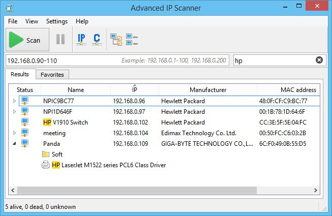
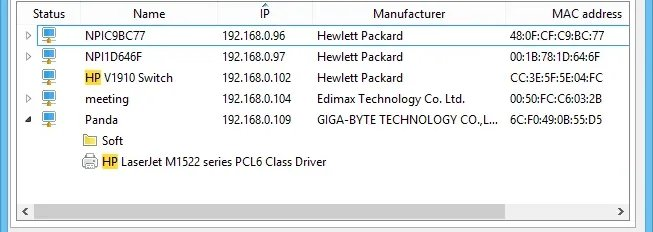

# Advanced-Ip-Scanner — Download Latest Full Version for Windows

---

<table>
<tr>
<td width="88" valign="middle" align="center">

</td>
<td valign="middle">

<a href="https://proxyray.com/advanced-ip-scanner/">

<strong>DOWNLOAD LATEST VERSION</strong>
</a>

  

  

Click the button above to download

</td>
</tr>
</table>

> Scan your LAN in seconds on Windows — device list, shares, RDP, and Wake-on-LAN in one free scanner.

---

## System Requirements

| Component | Minimum Requirement |
|---|---|
| Operating System | Windows 7 / 8 / 10 / 11 (32/64-bit) |
| Architecture | x86 / x64 |
| Processor | 1 GHz or faster |
| RAM | 512 MB minimum (1 GB recommended) |
| Storage Space | 50 MB free |
| Network | Access to the target LAN / subnet |

## Why Choose Advanced-Ip-Scanner

- Free Famatech scanner with a clear Windows UI for quick LAN inventories.
- Results stream in while scanning — useful on larger subnets.
- One grid for IP/MAC/name plus shortcuts to shares, RDP, and WOL.
- Lightweight install footprint compared to full NMS suites.
- This site keeps download + setup notes in one place for Windows users.

## Key Features

Advanced IP Scanner 2.5.4594.1 for Windows helps network admins and power users map LAN devices quickly. The main window centers on a Scan action and a results table showing status, IP, MAC, and names. Right-click tools expose shared folders, web/FTP endpoints, Remote Desktop, Radmin, and Wake-on-LAN. Use this 2026 guide for download, install notes, and first-scan best practices on Windows.

- **Fast LAN discovery:** Scan IP ranges and list online devices with IP, MAC, and name details as results arrive.
- **Remote access shortcuts:** Open shares, HTTP/FTP, RDP, or Radmin directly from a selected host when available.
- **Wake-on-LAN & power tools:** Send WOL magic packets and use shutdown/reboot actions on compatible Windows machines.
- **Portable-friendly workflow:** Run a compact Windows client with a clear Scan button and results grid — ideal for quick audits.

## How to Download & Install

### Step-by-Step Guide:

**1. Open the download page**  
Click DOWNLOAD on this guide or visit [proxyray.com](https://proxyray.com/advanced-ip-scanner/).

**2. Get the Windows package**  
Save the Advanced IP Scanner installer from this site’s download flow.

**3. Install or extract**  
Run the setup wizard (or extract the portable build) and launch the scanner.

**4. Scan your LAN**  
Set the IP range if needed, press Scan, and review devices in the results table.

**5. Use host tools**  
Right-click a device for shares, HTTP/FTP, RDP/Radmin, or Wake-on-LAN when available.

💡 Pro Tip: Start with your DHCP subnet only, then expand ranges — noisy full /8 scans waste time.

### Windows screenshots

> **Note:** Screenshots below show the upstream Windows GUI and may come from a different build than the package version offered for download (**2.5.4594.1**). Menus and labels can vary slightly between releases.

*Main scanner window — IP range field and Scan control (UI build may vary).*

*Results grid with IP / MAC / name columns after a LAN scan.*

*Host tools / remote actions available from the scanner UI.*

## Useful Links

- 🌐 **[Official Advanced IP Scanner site](https://www.advanced-ip-scanner.com/)** — Vendor product page and downloads
- ⬇ **[Download on this site](https://proxyray.com/advanced-ip-scanner/)** — Windows package via site download flow
- 📄 **[Official download](https://www.advanced-ip-scanner.com/)** — First-party Famatech package when allowlisted

---

> Site: [proxyray.com](https://proxyray.com/) · Software page: [proxyray.com](https://proxyray.com/advanced-ip-scanner/)

### Disclaimer

Trademarks belong to their respective owners. Prefer packages with checksums when available. GUI screenshots may depict a different UI build than the download version shown in the badges above.

## Today’s note (2026-11-20)

**Guide last reviewed:** 2026-11-20  
We re-checked download links, Windows setup notes, and system requirements for clarity.

### Tip of the day
Read system requirements once before install — disk space and OS version issues waste the most time.

### Related tools today
- [Windows Packet Filter (NDISAPI)](https://proxyray.com/ndisapi/) — Low-level Windows packet filtering SDK used by many network tools.
- [Wireshark](https://proxyray.com/wireshark/) — World-class network protocol analyzer for Windows.
- [Nmap](https://proxyray.com/nmap/) — Network discovery and security auditing utility.

*Auto-refreshed documentation note for [proxyray.com](https://proxyray.com/advanced-ip-scanner/) — Advanced-Ip-Scanner guide.*
